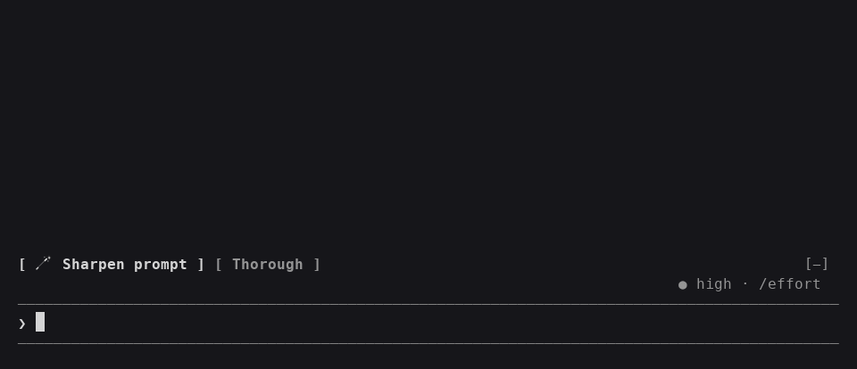

# Sharpen prompt (prompt-wand)

A Claude Code mod that turns a rough draft into a clear prompt before you send it.



You type what you want the way you think it: "add a dark mode toggle to settings and remember what the user picked". Press **🪄 Sharpen prompt** above the prompt box. A second model rewrites the draft for the model you have selected. It names the files that matter, says what done means and adds the checks to run. The rewrite goes into the prompt box. You read it, edit it if you like, and send it as your own message.

## Why

Agents do better work from a clear request, but writing one takes time. Most of us type a short line and hope. Sharpen prompt does the boring part:

- It keeps everything you wrote: paths, names, numbers, code, quoted text.
- It adds nothing you did not ask for. Where something is missing, it tells the model how to find it out, or to ask you.
- It reads your project's `CLAUDE.md` and top-level file list, so it can name real files.
- It follows the prompting notes for the target model (Opus, Sonnet, Haiku, Fable).
- You always see the result before it is sent, and **Undo** brings your draft back.

## Install

At the prompt of a Claude Code terminal session:

```
/plugin install prompt-wand --marketplace CodeWithBehnam/prompt-wand
```

Answer `y` to add the marketplace, then pick the user scope so the mod loads in every session.

From a shell:

```bash
claude plugin install prompt-wand --marketplace CodeWithBehnam/prompt-wand
```

In the Claude desktop app: click **+** next to the prompt box, then **Plugins**, **Add marketplace** with `CodeWithBehnam/prompt-wand`, then **Add plugin**.

Tested with Claude Code 2.1.325.

## Use

1. Type a draft in the prompt box. The band above the box shows **🪄 Sharpen prompt** and **🧩 With subagents**. It hides while the box is empty or holds a slash command.
2. Press one: click it, or press `Ctrl+X` then `Tab` to focus the band, the arrow keys to move between buttons, and `Enter` to press.
3. While it runs, the band shows the target model and the seconds passed. **Cancel** stops it.
4. The result:
   - A short rewrite replaces your draft. The band says what changed, with **Undo (until you send)**.
   - A rewrite over 15 lines, or one that arrives after you edited the draft, waits in a **Rewritten prompt** pane. Check it, then press **Replace draft**, **Copy** or **Discard**.
   - If the call fails, the band says why, with **Retry**.

### 🧩 With subagents

The second button rewrites the draft the same way and also splits the job across subagents. The prompt gets a `<subagent_plan>` section: each subagent's type, model and effort, its task and what it returns. The plan also says which parts run at the same time and how the main session combines and checks the results.

- It names only subagents your session has. Once the session has listed its agents, it uses that list: built-in, project, user and plugin agents. Before the first turn it reads the agent files in the project's `.claude/agents` and your `~/.claude/agents`, plus the built-in `general-purpose`.
- An agent whose definition sets a model keeps it.
- Every other subagent gets Claude Opus 5.5 at medium effort. The plan picks another model only where a part clearly suits it, and says why: Haiku for a plain search, Fable for the hardest reasoning.
- If the request is too small to split, the plan says so and uses one subagent.

**Quick** or **Thorough**: the button next to the wand switches the rewriter. Quick is fast for one-line drafts. Thorough takes longer and handles bigger requests. Your choice is remembered.

## Settings

Open the plugin's settings to change the models. Model names change often, so every one is editable.

| Setting | Default |
| --- | --- |
| Thorough model | `claude-opus-5-5` |
| Thorough effort | `medium` |
| Quick model | `claude-sonnet-5-5` |
| Quick effort | `low` |

## What it sends, and the cost

Each press makes one model call on your Claude account. It sends your draft, the `CLAUDE.md` and `AGENTS.md` files inside your project, and the names of the files and folders at the project's top level. Instruction files above the project, such as your personal `~/.claude/CLAUDE.md`, are not sent. **🧩 With subagents** also sends the name, description and model of each subagent your session can use, including the ones in your `~/.claude/agents`, but not their instructions. Nothing is sent until you press a button.

## Known limits

- In the Claude desktop app, the band appears after the first message of a new chat. The app starts the session only when you send, so there is nothing to draw the band before that. In the terminal it shows at once.
- The rewriter writes in the language and spelling of your draft. It does not run your request or edit files.

## Licence

MIT. See [LICENSE](LICENSE).
