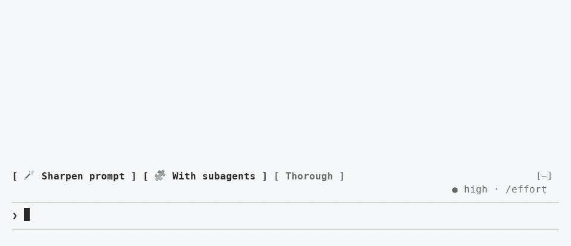

<div align="center">


</div>

<h1 align="center">Sharpen prompt</h1>

<p align="center">A Claude Code mod that turns a rough draft into a clear prompt before you send it.</p>

<p align="center">
  <a href="https://github.com/CodeWithBehnam/prompt-wand/releases"></a>
  <a href="LICENSE"></a>
  <a href="#install"></a>
  <a href="#requirements"></a>
</p>

A mod is a plugin that adds to Claude Code's own interface. Its plugin name is `prompt-wand`. This README describes version 0.2.3; `claude plugin list` shows the version you have, and the [releases page](https://github.com/CodeWithBehnam/prompt-wand/releases) lists the changes.



Type what you want the way you think it, for example "add a dark mode toggle to settings and remember what the user picked". Press **🪄 Sharpen prompt** in the band above the prompt box. A second model rewrites the draft for the model you have selected. Where the draft needs it, the rewrite names the files that matter, says what done means and adds the check that proves the change. A draft that is already clear changes little. You read the result, edit it if you like, and send it as your own message.

## What it does

| Button | What you get |
| --- | --- |
| **🪄 Sharpen prompt** | Your draft rewritten as a clear prompt for the selected model. |
| **🧩 With subagents** | The same rewrite, plus a plan that splits the work across the subagents your session has. |

Both buttons:

- keep everything you wrote: paths, names, numbers, code and quoted text
- add nothing you did not ask for, and tell the model how to find out what is missing, or to ask you
- read your project's `CLAUDE.md`, `.claude/CLAUDE.md` and `AGENTS.md` and its top-level file list, so the prompt can name real files
- follow the prompting notes for the target model family: Opus, Sonnet, Haiku or Fable
- never send anything for you: the rewrite goes into the prompt box, and **Undo** brings your draft back

## Why

Agents do better work from a clear request, but writing one takes time, so most of us type a short line and hope. Sharpen prompt does the slow part and leaves you the final say.

## Requirements

- Claude Code with mod support. Tested with Claude Code 2.1.325.
- Tested in the Claude Code terminal and the Claude desktop app. The band above the prompt box is not drawn in the VS Code extension.
- Each press makes one model call on your Claude account. See [What it sends, and the cost](#what-it-sends-and-the-cost).

## Install

At the prompt of a Claude Code terminal session:

```
/plugin install prompt-wand --marketplace CodeWithBehnam/prompt-wand
```

Answer `y` to add the marketplace, then pick the user scope so the mod loads in every session.

From a shell:

```bash
claude plugin install prompt-wand --marketplace CodeWithBehnam/prompt-wand
```

In the Claude desktop app: click **+** next to the prompt box, then **Plugins**, **Add marketplace** with `CodeWithBehnam/prompt-wand`, then **Add plugin**.

### Update or remove

```bash
claude plugin update prompt-wand@prompt-wand
```

Restart Claude Code after an update.

```bash
claude plugin uninstall prompt-wand@prompt-wand
```

## Use

1. Type a draft in the prompt box. The band above the box shows **🪄 Sharpen prompt**, **🧩 With subagents** and the mode. It hides while the box is empty or holds a slash command or a shell line.
2. Press a button: click it, or press `Ctrl+X` then `Tab` to focus the band, the arrow keys to move between buttons, and `Enter` to press.
3. While the rewrite runs, the band shows the target model, the mode and the seconds passed. **Cancel** stops it. Sending a prompt also stops it.
4. What happens next:

| Result | What you see |
| --- | --- |
| A rewrite of 15 lines or fewer | It replaces your draft. The band says what changed, with **Undo (until you send)** and **Again**. |
| A longer rewrite, one that arrives after you edited the draft, or one the box could not take (a dialog was open, say) | It waits in a **Rewritten prompt** pane. Check it, then press **Replace draft**, **Copy** or **Discard**. **Show** opens the pane again. |
| A failed call (an API error, an empty reply, a reply with no prompt in it) | The band says why, with **Retry** and **Dismiss**. Your draft is unchanged. |
| A draft or settings problem | The band says what to fix, with **Dismiss**. No call is made. |

After the first rewrite, both buttons shrink to their icons for the rest of the session.

### 🧩 With subagents

This button rewrites the draft the same way and also splits the job across subagents. The prompt gets a `<subagent_plan>` section: each subagent's type, its task, what it returns and, where the mod chooses them, its model and effort. The plan also says which parts run at the same time and how the main session combines and checks the results.

- It names only subagents your session has. Once the session has listed its agents, it uses that list: built-in, project, user and plugin agents. Before the first turn of a session it reads the agent files in the project's `.claude/agents` and in `~/.claude/agents` (or `$CLAUDE_CONFIG_DIR/agents` when that is set), plus the built-in `general-purpose`. Plugin agents can be missing until then.
- An agent whose file in one of those folders sets a model keeps it, and the plan names no model for it. The mod cannot see the model of built-in or plugin agents, so it treats them as having none.
- Every other subagent gets Claude Opus 5.5 at medium effort. The plan picks another model only where a part clearly suits it, and says why: Haiku for a plain search, Fable for the hardest reasoning.
- Where the project's instructions say subagents only report, the plan keeps the edits in the main session.
- If the request is too small to split, the plan says so and uses one subagent.

### Quick or Thorough

The button next to the others switches the rewriter. **Thorough**, the default, uses Claude Opus 5.5 at medium effort. **Quick** uses Claude Sonnet 5.5 at low effort, a lighter choice for short drafts. Your choice is remembered across sessions.

## Settings

The plugin's settings choose the models for each mode. Model names change often, so every one is editable.

| Setting | Default | Takes |
| --- | --- | --- |
| Thorough model | `claude-opus-5-5` | A model alias or a full model ID |
| Thorough effort | `medium` | `low`, `medium`, `high`, `xhigh` or `max` |
| Quick model | `claude-sonnet-5-5` | A model alias or a full model ID |
| Quick effort | `low` | `low`, `medium`, `high`, `xhigh` or `max` |

## What it sends, and the cost

Nothing is sent until you press a button. Each press makes one model call on your Claude account, with:

- your draft, up to 40,000 characters
- the `CLAUDE.md`, `.claude/CLAUDE.md` and `AGENTS.md` files inside your project, cut to 24,000 characters in all
- the project's full path, and the names of the first 150 files and folders at its top level (`.git`, `node_modules`, `.venv`, `__pycache__` and `.DS_Store` are left out)
- the name of the target model and today's date

Instruction files above the project, such as your personal `~/.claude/CLAUDE.md`, are not sent. **🧩 With subagents** also sends, for up to 40 subagents your session can use, the name, where it is defined, its model and the first 300 characters of its description, including the ones in your `~/.claude/agents`, but not their instructions.

The call times out after five minutes. The mod makes no other network calls and runs no commands. The only file it writes is its own small store in Claude Code's configuration folder, which keeps your Quick or Thorough choice. The full privacy policy is in [PRIVACY.md](PRIVACY.md).

## Hooks it uses

The mod watches a few Claude Code events. None of them changes what passes through it.

| Hook | What it does |
| --- | --- |
| `session.start` | Brings back your Quick or Thorough choice, clears a rewrite left running by a reload, and asks the band to draw. |
| `session.attach` | Asks the band to draw again when a window attaches to the session. |
| `agent.offer` | Notes the name, description and source of each subagent type the session offers the model, for **🧩 With subagents**. Every offer passes on unchanged. |
| `prompt.edit` | Notes whether the prompt box is empty or holds a command, so the band can hide. Your typing passes on unchanged. |
| `prompt.submit` | When you send a prompt, stops a rewrite that is still running and resets the band. Your prompt is sent unchanged. |
| `ui.render` | Draws the band above the prompt box and the **Rewritten prompt** pane. |

## Known limits

- In the Claude desktop app, the band appears after the first message of a new chat. The app starts the session only when you send, so there is nothing to draw the band before that. In the terminal it shows at once.
- Slash commands and shell lines (a draft that starts with `!`) are not rewritten: they only work as typed. A draft that starts with a path such as `/Users/me/app` is rewritten as usual.
- A draft over 40,000 characters is refused.
- The band learns about the draft from your typing. If you bring back an earlier prompt into an empty box, with the up arrow for example, the band appears once you type.
- The rewriter has notes for the Opus, Sonnet, Haiku and Fable families. For any other model it uses the general rules only.
- Agent files are read only from the top level of each agents folder, not from subfolders.
- The rewriter writes in the language and spelling of your draft. It does not run your request or edit files.

## Troubleshooting

| The band says | What to do |
| --- | --- |
| `Set "Thorough model" in the prompt-wand settings.` (or Quick, or an effort) | Fill in that setting. Efforts take `low`, `medium`, `high`, `xhigh` or `max`. |
| `The draft is over 40,000 characters.` | Shorten the draft. |
| `the API answered … (HTTP …)` | The model call failed. Check that your account can use the model in the settings, then press **Retry**. |
| `its reply held no prompt in the expected tags` | The rewriter's reply was cut off or malformed, which a very long draft can cause. Press **Retry**, or shorten the draft. |
| `the rewriter sent back no text` or `the call was cut off before it finished` | Press **Retry**. |

## Development

To run the mod from source, in place of the installed copy, first get your own copy of this repository: use the green **Code** button at the top of its GitHub page, or fork it. Look through the code. Then start Claude Code from the folder above it:

```bash
claude --plugin-dir ./prompt-wand
```

In an interactive session Claude Code watches the folder and reloads the mod when you save a file. It also writes the API types to `.claude-plugin/types/`, which git ignores.

Check a change with:

```bash
claude plugin validate ./prompt-wand
tsc -p ./prompt-wand
```

`tsc` is the TypeScript compiler, which you install yourself; the repository has no `package.json`. It also needs the types that Claude Code writes when it loads the folder. The repository has no automated tests yet, so also try the change in a live session.

| File | Job |
| --- | --- |
| `.claude-plugin/plugin.json` | The mod's name, version and settings with their defaults |
| `.claude-plugin/marketplace.json` | Makes the repository a marketplace for `/plugin install` |
| `hooks/hooks.json` | Names the hooks module |
| `hooks/register.tsx` | The band, the buttons, the preview pane and every hook |
| `hooks/pipeline.ts` | Reads the project context and the agent files, and makes the model call |
| `hooks/rewrite.ts` | The rewriter's rules and how its reply becomes the new draft |
| `hooks/profiles.ts` | The prompting notes for each model family |
| `hooks/agents.ts` | Parses agent files and builds the agent list for the rewriter |
| `types/index.d.ts` | The state the mod keeps |

## Licence

MIT. See [LICENSE](LICENSE).

## Contributing

Want to contribute or run it locally? See [CONTRIBUTING.md](CONTRIBUTING.md). Everyone who takes part follows the [code of conduct](CODE_OF_CONDUCT.md).

Bug reports and ideas are welcome through the issue forms. For a security problem, follow [SECURITY.md](SECURITY.md) and do not open a public issue.

Thanks to everyone who has contributed:

<a href="https://github.com/CodeWithBehnam/prompt-wand/graphs/contributors">
  
</a>

## Star history

The chart shows the repository's GitHub stars over time, from [star-history.com](https://www.star-history.com/#codewithbehnam/prompt-wand&Date). It updates by itself. Click it to open the full chart.

<p align="center">
  <a href="https://www.star-history.com/#codewithbehnam/prompt-wand&Date">
    <picture>
      <source media="(prefers-color-scheme: dark)" srcset="https://api.star-history.com/svg?repos=codewithbehnam/prompt-wand&type=Date&theme=dark">
      <source media="(prefers-color-scheme: light)" srcset="https://api.star-history.com/svg?repos=codewithbehnam/prompt-wand&type=Date">
      
    </picture>
  </a>
</p>
